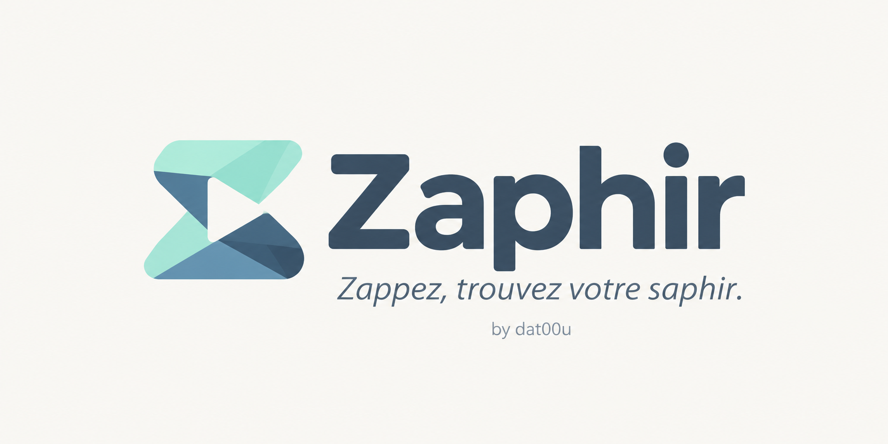

# Zaphir — by dat00u

**Zappez, trouvez votre saphir.**

Zaphir (by dat00u, anciennement Dat00u) est un lecteur IPTV gratuit et sans publicité pour Android TV, Google TV, Fire TV, les box Android, les téléphones et les tablettes.

**L'application ne vend ni ne fournit d'abonnement, de film ni de série.** Elle lit la source que vous ajoutez vous-même : abonnement Xtream, lien ou fichier M3U. Utilisez uniquement une source à laquelle vous avez droit.

**Essayer sans abonnement :** sur l'écran de connexion, « Essayer sans abonnement » ouvre une démo de chaînes gratuites (France, infos, monde arabe). Elles viennent de la liste publique [Free-TV/IPTV](https://github.com/Free-TV/IPTV), qui ne recense que des chaînes gratuites et légales ; Zaphir n'en héberge aucune.

Version disponible : **0.17.0 · Android 8 et suivants · Français, English, العربية**. [Télécharger l'APK signée](https://github.com/dat00udev-sys/dat00u-distribution/releases/download/v0.17.0/Zaphir-0.17.0.apk). Aucun compte GitHub n'est nécessaire.

[Installer l'application](INSTALLATION.md) · [Nouveautés](CHANGELOG.md)

## Ce que vous pouvez faire

| Écran | À quoi il sert |
|---|---|
| Accueil | Reprendre un film ou un épisode, retrouver favoris et chaînes récentes. |
| TV | Parcourir les chaînes par dossier ; en plein écran, Retour ouvre la liste des chaînes par-dessus l'image, puis la liste des dossiers : on change de chaîne ou de dossier sans quitter l'image. Le menu de la chaîne affiche les programmes du jour. Les logos des chaînes sont trouvés automatiquement, et une chaîne proposée en plusieurs qualités n'a qu'une tuile. En plein écran, une barre discrète montre la chaîne, sa qualité et les chaînes voisines, même sans guide des programmes. |
| Films et Séries | Dossiers en liste ou en mosaïque, fiches avec saisons et épisodes, reprise de lecture. |
| Favoris | Vos chaînes, films et séries préférés au même endroit. |
| Réglages | Langue, thème, ordre et visibilité des dossiers, contrôle parental, sources. |

## Vos données sur votre appareil

Les identifiants de vos sources sont chiffrés sur l'appareil. L'application ne contacte que les serveurs de vos sources et ce dépôt, pour vérifier les mises à jour. Elle n'envoie aucune donnée personnelle, n'affiche aucune publicité et ne fait aucune statistique.

## Télécharger et mettre à jour

Les APK signées sont dans les [Releases](https://github.com/dat00udev-sys/dat00u-distribution/releases).

L'application vous prévient elle-même quand une nouvelle version est disponible. Installez-la **sans désinstaller** : vos sources, favoris et réglages sont conservés.

Le fichier d'annonce `versions.json` est signé et ne contient aucune donnée personnelle.

## Besoin d'aide ?

Pour signaler un problème, ouvrez une issue en indiquant :
- la version de l'app ;
- l'appareil ;
- les étapes qui reproduisent le problème.

**Ne joignez jamais un identifiant, un mot de passe ni l'adresse de votre source.**

**English:** Zaphir is a free IPTV player for Android TV, Google TV, Fire TV, Android boxes, phones and tablets. It sells no subscription and hosts no content: it plays the source you add yourself, or a demo of free channels from the public [Free-TV/IPTV](https://github.com/Free-TV/IPTV) list. French, English and Arabic.
